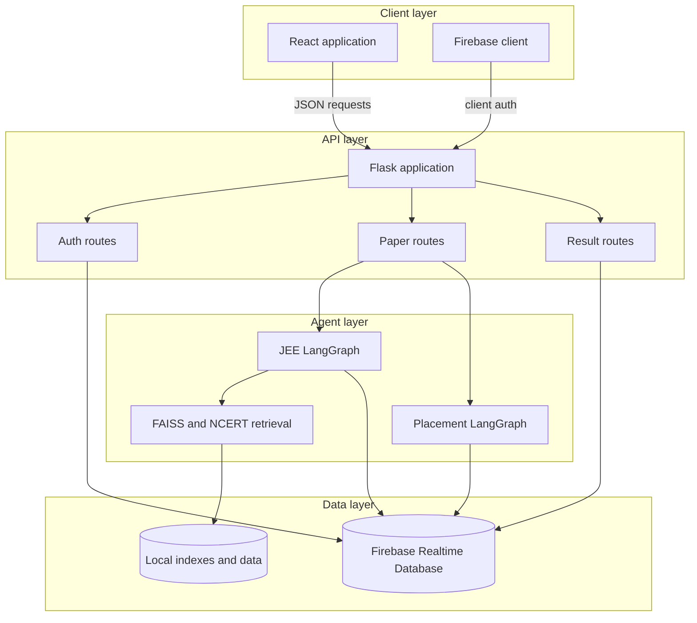
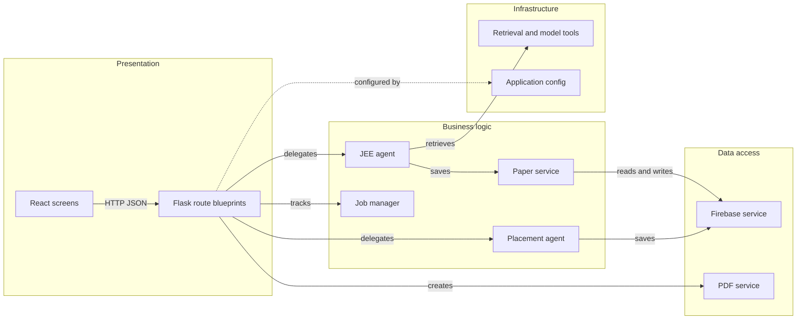

# Architecture Diagram

JEE Question Generator is a React and Flask application with Firebase
authentication and persistence, plus separate JEE and placement LangGraph
workflows.

## Application Architecture

<!-- mermaid-checked: no \n, no em-dash/en-dash, no {} in labels, subgraphs are id["label"], arrows are -->|"label"|, all subgraphs closed by end, ids unique -->

### Technology Stack Summary

| Layer | Technology | Version | Purpose |
| --- | --- | --- | --- |
| Client | React and React Router | package manifest | Screens and navigation |
| API | Flask and Flask-CORS | requirements manifest | HTTP API and browser access |
| Workflow | LangGraph | 0.0.56 | Agent state transitions |
| Retrieval | FAISS, NumPy, Pandas | requirements manifest | Similar-question and content retrieval |
| Auth | Firebase Auth and Pyrebase | requirements manifest | Account and token handling |
| Persistence | Firebase Realtime Database | Firebase config | Papers, users, and results |

### Data Storage & External Services

Firebase Realtime Database stores user profiles, JEE papers, placement
papers, test results, deleted-paper indexes, and compact user indexes. Local
FAISS and NCERT assets support retrieval. Model providers and Google OAuth are
configured through local secrets and environment-specific settings.

### Key Architectural Decisions

- Flask blueprints separate authentication, generation, CRUD, and results.
- LangGraph keeps JEE generation streamable while placement generation stays
  synchronous and compact.
- The React hash router supports GitHub Pages deployment.

## Component Relationships

<!-- mermaid-checked: no \n, no em-dash/en-dash, no {} in labels, subgraphs are id["label"], arrows are -->|"label"|, all subgraphs closed by end, ids unique -->

### Component Inventory

| Component | Layer | Type | Responsibility |
| --- | --- | --- | --- |
| React screens | Presentation | Client UI | Auth, generation, tests, and history |
| Flask route blueprints | Presentation | HTTP boundary | Validate input and dispatch work |
| JEE agent | Business logic | LangGraph workflow | Personalized JEE generation |
| Placement agent | Business logic | LangGraph workflow | Topic-based MCQ generation |
| Job manager | Business logic | In-memory coordinator | Background JEE progress |
| Paper service | Business logic | Persistence helper | Save papers and calculate weak concepts |
| Firebase service | Data access | SDK adapter | Admin database and auth clients |
| PDF service | Data access | Renderer | Create downloadable placement PDFs |
| Retrieval and model tools | Infrastructure | Integration layer | Search context and call models |
| Application config | Infrastructure | Factory configuration | CORS, environment, and blueprint setup |
