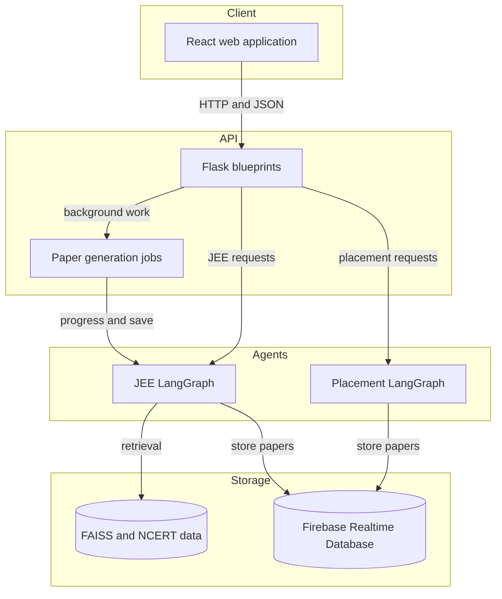

# JEE Question Generator

An open-source learning application that generates personalized JEE practice
papers and placement-preparation papers. The project combines a React
frontend, a Flask API, LangGraph workflows, retrieval from question and
NCERT data, and Firebase persistence.

## Live site

[Open the live application](https://sujalgawas.github.io/JEE_question_generator/)

The production frontend is hosted on GitHub Pages. The API is deployed
separately and is selected through the frontend environment configuration.

## What this project is about

The application helps students practise with generated multiple-choice
questions instead of repeatedly solving the same static paper. It has two
learning modes:

- **JEE mode** generates Physics, Chemistry, and Mathematics questions,
  retrieves supporting context, creates distractors, and uses previous test
  results to increase the weight of weak concepts.
- **Placement mode** is a smaller workflow for topic-based placement
  preparation. It creates a paper, optionally checks its options, stores it,
  and supports taking, scoring, and downloading the paper.

## Features

- Email/password authentication backed by Firebase.
- JEE paper generation with subject and concept weightage.
- Weak-concept analysis from stored test results.
- Retrieval-augmented question generation using question indexes and NCERT
  content.
- Distractor generation and option validation.
- Placement topic selection and paper history.
- Test submission, scoring, analytics, and PDF download.
- React single-page UI with separate JEE and placement flows.

## How it works

1. A user signs up or logs in and receives a Firebase ID token.
2. The frontend sends the token with generation and test requests.
3. Flask validates the token and calls the selected LangGraph agent.
4. The agent retrieves context and generates question data.
5. The backend stores papers and results in Firebase Realtime Database.
6. The frontend reads the stored paper or result and presents the next
   practice flow.

See the [architecture guide](docs/architecture.md) for the system view and
the [JEE agent guide](docs/jee/agent.md) and
[placement agent guide](docs/placement/agent.md) for the two workflows.

## Who it is for

- JEE students who want adaptive practice across PCM concepts.
- Students preparing for placement aptitude or technical screening topics.
- Contributors interested in educational tooling, retrieval-augmented
  generation, React, Flask, or LangGraph.

## Get started

### Prerequisites

- Python 3.8 or later.
- Node.js 16 or later and npm.
- A Firebase project and the required server-side configuration files.
- Credentials for the model provider and retrieval services used by the
  selected agent.

### Clone the repository

```bash
git clone https://github.com/sujalgawas/JEE_question_generator.git
cd JEE_question_generator
```

### Configure the backend

Create and activate a virtual environment, then install the backend
dependencies:

```powershell
python -m venv venv
.\venv\Scripts\Activate.ps1
pip install -r requirements.txt
```

On macOS or Linux, activate the environment with:

```bash
source venv/bin/activate
```

Place Firebase and OAuth configuration in local, untracked files as expected
by [backend/config.py](backend/config.py). Do not commit service-account keys,
OAuth secrets, model tokens, or production environment files.

### Configure the frontend

```powershell
cd frontend
npm install
```

For local development, set `REACT_APP_API_URL` in
[frontend/.env.development](frontend/.env.development) to the URL of the
running Flask server.

### Run locally

Start the API from the repository root:

```powershell
python server.py
```

The development server listens on `http://127.0.0.1:8081`. In a second
terminal, start the React application:

```powershell
cd frontend
npm start
```

The frontend normally opens at `http://localhost:3000`.

### Run tests

Backend regression tests:

```powershell
.\venv\Scripts\python.exe -m pytest backend\tests
```

Frontend tests and production build:

```powershell
cd frontend
npm test -- --watchAll=false
npm run build
```

## Repository structure

```text
backend/
  agents/          JEE and placement LangGraph workflows
  routes/          Flask API blueprints
  services/        Firebase, auth, paper, job, and PDF services
  tools/           Model and embedding integrations
  tests/           Backend regression tests
frontend/
  src/             React routes, screens, and API calls
data/              Retrieval indexes and local model data
docs/              Project and subsystem documentation
server.py          Flask application entry point
requirements.txt   Python dependencies
```

## Basic architecture

<!-- mermaid-checked: no \n, no em-dash/en-dash, no {} in labels, subgraphs are id["label"], arrows are -->|"label"|, all subgraphs closed by end, ids unique -->


For component-level diagrams and route details, start at the
[documentation index](docs/README.md).

## Documentation

- [Documentation home](docs/README.md)
- [Application architecture](docs/architecture.md)
- [Backend](docs/backend.md)
- [Frontend](docs/frontend.md)
- [Database and persistence](docs/database.md)
- [Routes](docs/routes.md)
- [API reference](docs/api.md)
- [JEE agent](docs/jee/agent.md)
- [Placement agent](docs/placement/agent.md)

## Contributing

Please read [contribution.md](contribution.md) before opening a pull request.
Small documentation improvements, reproducible bug reports, tests, and
focused architectural changes are welcome.

## Support

- Read the [documentation](docs/README.md) first.
- Search [existing issues](https://github.com/sujalgawas/JEE_question_generator/issues)
  before opening a new one.
- [Open a bug report or feature request](https://github.com/sujalgawas/JEE_question_generator/issues/new/choose).
- For security concerns, do not publish credentials or exploit details in a
  public issue; contact the repository owner privately.

## Demo

The original walkthrough video is available on
[YouTube](https://www.youtube.com/watch?v=p_Rlodf7yZk).

## License

No license file is currently included. Until a license is added, the
repository should be treated as source-available rather than automatically
licensed for redistribution.
