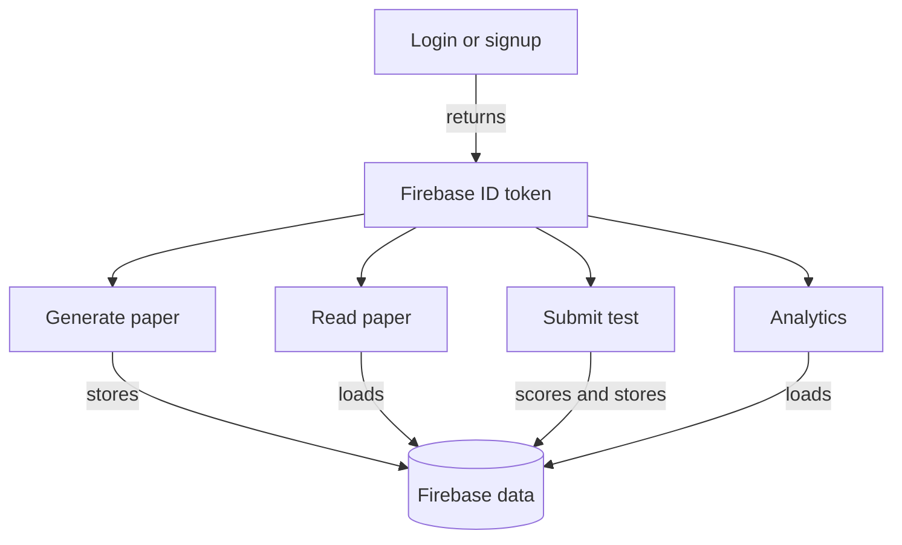

# API Reference

The API returns JSON for normal requests. Requests that require a user include
an ID token in the JSON body as `token`; generation and test endpoints also
include mode-specific fields.

<!-- mermaid-checked: no \n, no em-dash/en-dash, no {} in labels, subgraphs are id["label"], arrows are -->|"label"|, all subgraphs closed by end, ids unique -->

## Common response conventions

- `200` indicates a successful read or operation.
- `201` is used by placement paper creation and placement paper lookup
  operations.
- `400` indicates missing or malformed request data.
- `401` indicates an invalid or expired token.
- `403` indicates an authenticated user is not authorized for the resource.
- `404` indicates a missing job or paper.
- `500` indicates an unexpected server error.

## Endpoint index

| Method | Endpoint | Purpose |
| --- | --- | --- |
| POST | `/signup` | Create a Firebase account and user record |
| POST | `/login` | Authenticate and return an ID token |
| POST | `/generate-paper` | Synchronously generate and save a JEE paper |
| POST | `/start-paper-generation` | Start a background JEE job |
| GET | `/paper-generation-status/:job_id` | Read background job progress |
| POST | `/user-active-jobs` | List jobs for the authenticated user |
| POST | `/cancel-paper-generation/:job_id` | Cancel an unfinished job |
| POST | `/get-paper-for-test` | Load a JEE paper |
| POST | `/retrieve-papers` | List the user's JEE papers |
| POST | `/delete-paper` | Mark a JEE paper deleted |
| POST | `/placement_question` | Generate and save a placement paper |
| POST | `/placement_paper_id` | List placement paper IDs for a user |
| POST | `/placements_take_test` | Load a placement paper |
| POST | `/placements_submit_test` | Score and save a placement test |
| POST | `/placement_download_pdf` | Download a placement paper PDF |
| POST | `/submit-test-result` | Score and save a JEE test |
| POST | `/get-user-analytics` | Load user test analytics |
| GET | `/health` | Return `OK` |

Payload details are intentionally kept close to their flows in the
[JEE API](jee/api.md) and [placement API](placement/api.md) pages.
