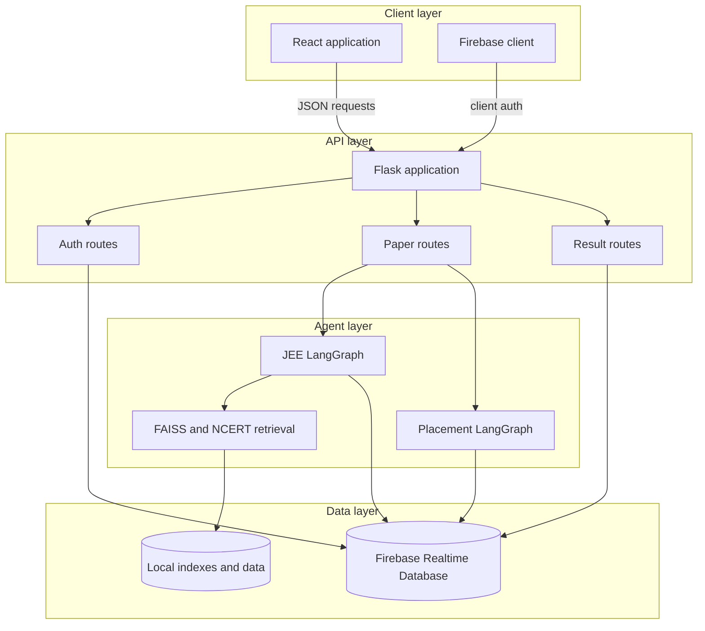

# Application Architecture

The application is a React single-page client backed by a Flask API. The API
coordinates Firebase authentication and persistence with two LangGraph
workflows and retrieval/model integrations.

<!-- mermaid-checked: no \n, no em-dash/en-dash, no {} in labels, subgraphs are id["label"], arrows are -->|"label"|, all subgraphs closed by end, ids unique -->

## Stack summary

| Layer | Technology | Version or source | Purpose |
| --- | --- | --- | --- |
| Client | React and React Router | `frontend/package.json` | Screens, auth state, and mode-specific flows |
| API | Flask and Flask-CORS | `requirements.txt` | HTTP endpoints and browser access |
| Workflow | LangGraph | `0.0.56` | JEE and placement agent graphs |
| Retrieval | FAISS, NumPy, Pandas | `requirements.txt` | Similar-question and supporting-content retrieval |
| Authentication | Firebase Auth and Pyrebase | `requirements.txt` | Account creation, login, and ID tokens |
| Persistence | Firebase Admin Realtime Database | Firebase configuration | Papers, users, tests, and results |
| Deployment | GitHub Pages and a separately deployed API | repository configuration | Production hosting |

## Data storage and external services

Firebase Realtime Database stores user profiles, JEE papers, placement papers,
test results, deleted-paper indexes, and user paper indexes. Local FAISS and
NCERT assets support retrieval during generation. Model providers and Google
OAuth are configured outside source code through local secrets and
environment-specific configuration.

## Architectural decisions

- Flask blueprints keep authentication, paper generation, CRUD, and result
  concerns separate while sharing one application factory.
- LangGraph models generation as explicit state transitions, allowing the JEE
  workflow to stream progress and the placement workflow to remain small.
- The frontend uses a hash router because the production client is hosted on
  GitHub Pages.
