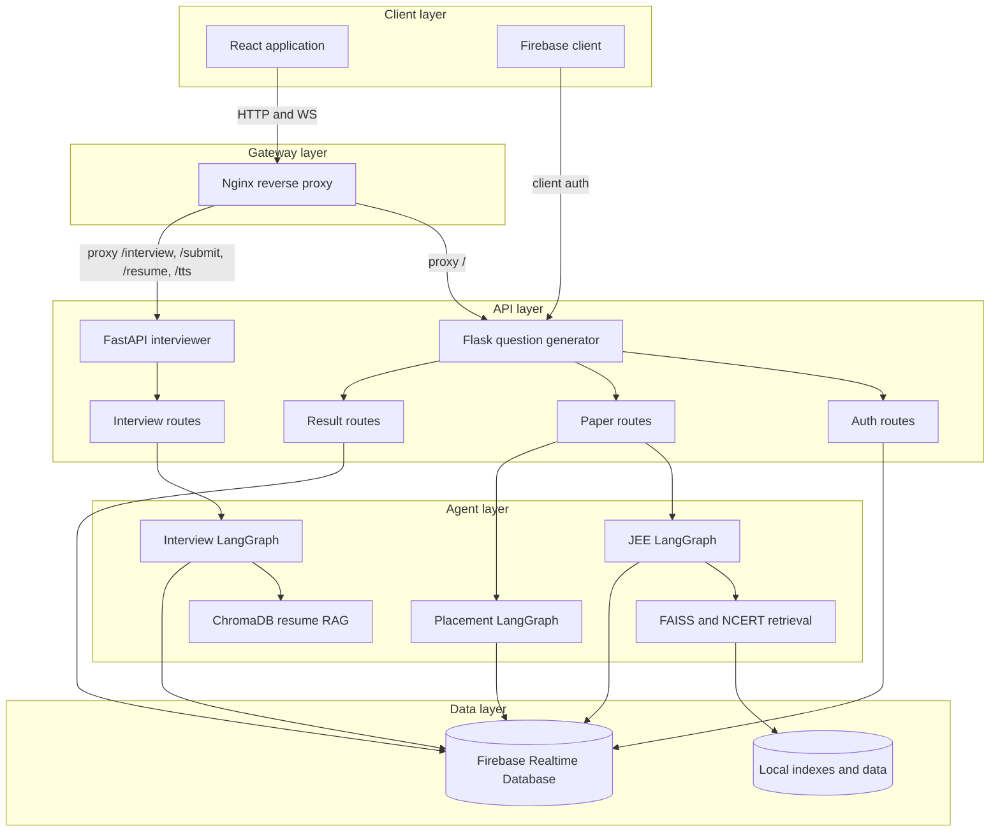

# Application Architecture

The application is a React single-page client backed by a Flask API and a
FastAPI Interviewer microservice, unified by an Nginx reverse proxy gateway.
The system coordinates Firebase authentication and persistence with three
LangGraph workflows (JEE, Placement, and Interviewer) and retrieval/model integrations.

<!-- mermaid-checked: no \n, no em-dash/en-dash, no {} in labels, subgraphs are id["label"], arrows are -->|"label"|, all subgraphs closed by end, ids unique -->

## Stack summary

| Layer | Technology | Version or source | Purpose |
| --- | --- | --- | --- |
| Client | React and React Router | `frontend/package.json` | Screens, auth state, and mode-specific flows |
| Gateway | Nginx | `nginx.conf` | Reverse proxy, dynamic upstream routing, and WebSocket upgrades |
| API | Flask and FastAPI | `requirements.txt`, `interviewer/requirements.txt` | REST endpoints, background tasks, and real-time WebSockets |
| Workflow | LangGraph | `0.0.56` / `langgraph` | JEE, placement, and conversational interview agent graphs |
| Retrieval | FAISS, ChromaDB, PyMuPDF | `requirements.txt`, `interviewer/requirements.txt` | Similar questions, NCERT content, and candidate resume RAG |
| Speech | Groq Whisper and UnrealSpeech | `interviewer/requirements.txt` | Voice transcription (STT) and low-latency speech synthesis (TTS) |
| Authentication | Firebase Auth and Pyrebase | `requirements.txt` | Account creation, login, and ID tokens |
| Persistence | Firebase Admin Realtime Database | Firebase configuration | Papers, users, tests, results, and interview sessions |
| Deployment | Docker Compose, GitHub Pages, ngrok | repository configuration | Containerized multi-service deployment and hosting |

## Data storage and external services

Firebase Realtime Database stores user profiles, JEE papers, placement papers,
test results, deleted-paper indexes, interview sessions, and candidate reviews.
Local FAISS, NCERT, and ChromaDB assets support retrieval during generation
and live interviews. Model providers (Groq, OpenAI, UnrealSpeech) are configured
outside source code through local secrets and environment-specific configuration.

## Architectural decisions

- Flask blueprints keep question generation, CRUD, and result concerns modular
  while sharing an application factory.
- The Interviewer service runs independently on FastAPI to support asynchronous
  WebSocket streaming, binary audio ingestion, and ChromaDB vector searching.
- LangGraph models generation as explicit state transitions across all three
  agent workflows (JEE, placement, and real-time mock interviews).
- An Nginx gateway unifies the Flask and FastAPI services under a single origin,
  simplifying CORS and client networking.
- The frontend uses a hash router because the production client is hosted on
  GitHub Pages.

