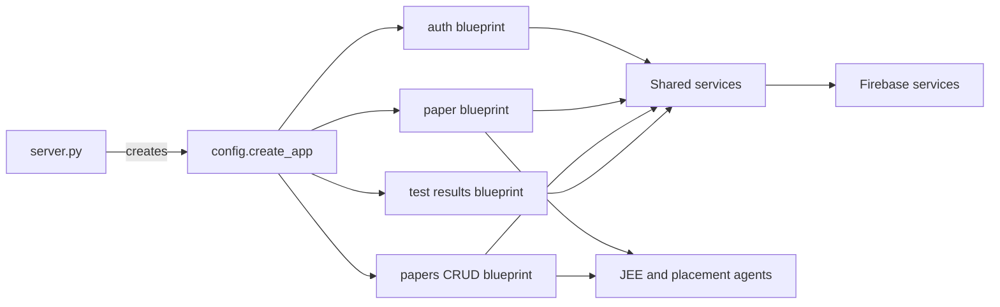

# Backend

The backend starts in [server.py](../server.py), adds `backend/` to the
Python import path, creates the Flask app, registers blueprints, and exposes
`GET /health`.

<!-- mermaid-checked: no \n, no em-dash/en-dash, no {} in labels, subgraphs are id["label"], arrows are -->|"label"|, all subgraphs closed by end, ids unique -->

## Backend modules

| Area | Location | Responsibility |
| --- | --- | --- |
| App factory | `backend/config.py` | CORS, secrets, and blueprint registration |
| Authentication | `backend/routes/auth.py` | Signup and login |
| JEE generation | `backend/routes/paper.py` | Synchronous and background paper generation |
| Paper CRUD | `backend/routes/papers_crud.py` | Read, delete, placement, and PDF operations |
| Results | `backend/routes/test_results.py` | Submit tests and read analytics |
| Jobs | `backend/services/job_manager.py` | In-memory progress and lazy JEE graph initialization |
| Persistence | `backend/services/paper_service.py` | Save papers and calculate weak concepts |
| Firebase | `backend/services/firebase_service.py` | Firebase Admin and Pyrebase clients |
| Agents | `backend/agents/` | LangGraph workflows and model tools |

## Request lifecycle

The frontend sends a Firebase ID token in the JSON body. Routes validate the
token, call a service or agent, and return JSON. Generation can be synchronous
through `/generate-paper` or tracked through the background job endpoints.
The in-memory job map is process-local; production deployments should treat
it as temporary progress state rather than durable storage.
