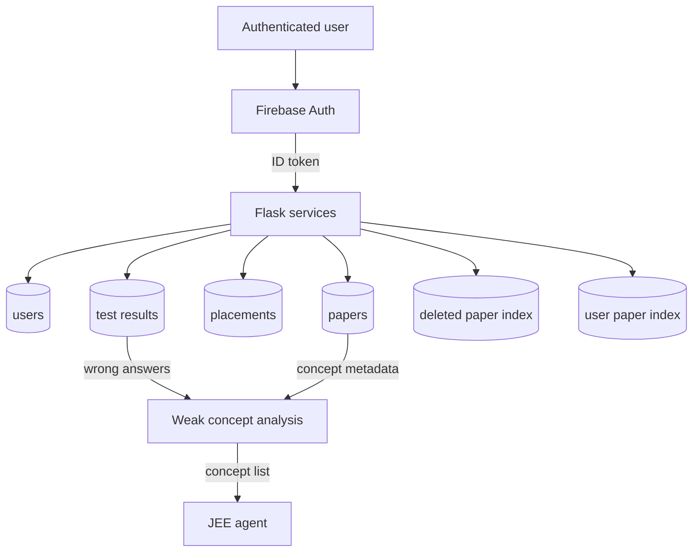

# Database and Persistence

The backend uses Firebase Realtime Database through the Firebase Admin SDK
for server-side reads and writes. Pyrebase is used for email/password
authentication. The exact Firebase project is selected by local secret
configuration, not by the source code.

<!-- mermaid-checked: no \n, no em-dash/en-dash, no {} in labels, subgraphs are id["label"], arrows are -->|"label"|, all subgraphs closed by end, ids unique -->

## Main records

| Path | Used for |
| --- | --- |
| `users/{uid}` | Display name, email, and a compact paper/test index |
| `papers/{paperId}` | Generated JEE paper and ownership metadata |
| `placements/{paperId}` | Generated placement paper and ownership metadata |
| `test_results/{resultId}` | Submitted test answers, scores, and timing |
| `users/{uid}/papers/{paperId}` | User-facing paper summary index |
| `users/{uid}/test_results/{resultId}` | User-facing result summary index |
| `deleted_paper_index/{uid}/{paperId}` | JEE papers marked as deleted |

## Persistence rules

JEE papers are saved by `save_user_paper`, which adds ownership and creation
metadata before writing both the paper and a user index. Placement papers are
written directly by the placement route. Test submissions write a detailed
result and a compact user result index. Weak concepts are calculated by
comparing submitted answers with the saved paper's option values and concept
list.

Do not place service-account JSON or API keys in documentation, commits, or
client bundles. Rotate any credential that has been exposed and use deployment
secret storage.
