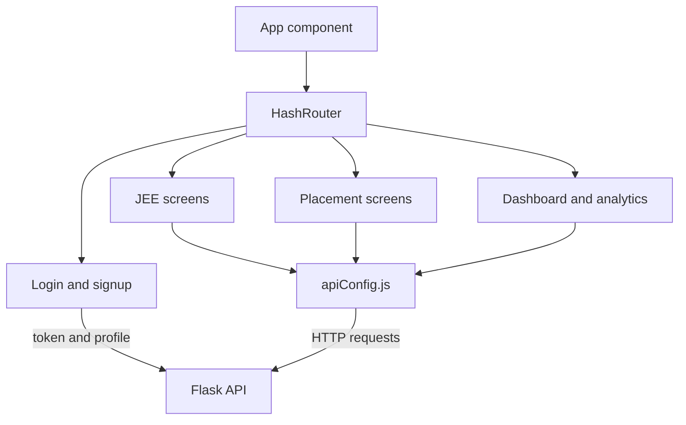

# Frontend

The frontend is a React application in [frontend/src](../frontend/src). It
uses `HashRouter`, stores the selected mode in local storage, stores the
Firebase ID token in secure same-site cookies, and calls the Flask API through
`REACT_APP_API_URL`.

<!-- mermaid-checked: no \n, no em-dash/en-dash, no {} in labels, subgraphs are id["label"], arrows are -->|"label"|, all subgraphs closed by end, ids unique -->

## Routes and screens

| Hash route | Screen | Access |
| --- | --- | --- |
| `/` | Landing page or selected home screen | Public or authenticated |
| `/login` | Login | Public |
| `/signup` | Signup | Public |
| `/auth/callback` | OAuth callback | Public |
| `/dashboard` | Dashboard | Authenticated |
| `/past-papers` | JEE paper history | Authenticated |
| `/analytics` | Test analytics | Authenticated |
| `/mcq-test/:paperId` | JEE test | Authenticated |
| `/placement` | Placement home | Authenticated |
| `/placement-test` | Placement test setup | Authenticated |
| `/placement-history` | Placement paper history | Authenticated |
| `/placementMCQ-test/:paperId` | Placement test | Authenticated |
| `/contact` | Contact page | Public |

## Build and deployment

`npm start` runs local development, `npm test` runs React tests, and
`npm run build` creates the production bundle. `npm run deploy` publishes
`build/` through GitHub Pages. The `homepage` field in
[frontend/package.json](../frontend/package.json) matches the live site path.
