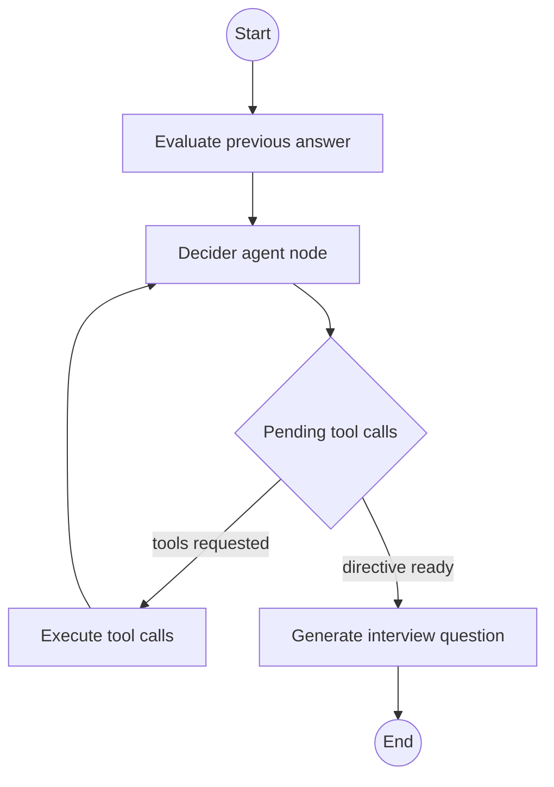

# Interview Agent

The interview agent is an autonomous LangGraph state machine located in
[interviewer/app/agent.py](../../interviewer/app/agent.py). For each turn of
the interview, it evaluates the candidate's previous response, gathers context
via specialized tools, and generates a conversational question.

<!-- mermaid-checked: no \n, no em-dash/en-dash, no {} in labels, subgraphs are id["label"], arrows are -->|"label"|, all subgraphs closed by end, ids unique -->

## Agent state

The graph operates on `interview_state` containing:

- `username`: Candidate username identifier.
- `role`: Target role (`backend`, `fullstack`, or `ai/ml`).
- `questions`: Mapping of question numbers to question strings.
- `answer`: Mapping of question numbers to candidate answers.
- `agent_memory`: Qualitative evaluation notes per question.
- `max_questions`: Maximum question count (default `10`).
- `current_question`: Current active question index (1-based).
- `pending_tool_calls`: Tool invocations requested by the decider.
- `tool_iterations`: Tool recursion counter (capped at 2 per turn).
- `gathered_context`: Accumulated string outputs from tool calls.
- `question_directive`: Detailed instruction guiding question synthesis.

## Workflow stages

1. **`evaluate_answer`**: When `current_question > 0`, the agent submits the
   previous question and candidate answer to the LLM. It records a 2 to 3
   sentence evaluation in `agent_memory` assessing technical depth and whether
   follow-up questions are needed. It then increments `current_question`.
2. **`decider_agent`**: Inspects interview history, candidate evaluation notes,
   and any context gathered so far. If more domain context is needed, it outputs
   tool calls in JSON. If sufficient context exists, it outputs an empty tool
   list and writes the `question_directive`.
3. **`execute_tools`**: Resolves tool calls against `TOOLS_REGISTRY` and appends
   formatted results to `gathered_context`.
4. **`should_continue_tools`**: Loops back to `decider_agent` if pending tools
   remain and `tool_iterations < 2`; otherwise proceeds to question generation.
5. **`generate_question`**: Formulates a spoken, natural question using
   the director directive and accumulated context, storing it in `questions`.

## Tool registry

| Tool | Purpose | Args |
| --- | --- | --- |
| `must_have_hr_questions` | Fetches behavioral, conflict, salary, or notice period questions | `focus_topic` |
| `skill_related_questions` | Matches role requirements with skills found in the candidate resume | `target_skill` |
| `get_past_conversion` | Retrieves a sliding window of recent Q&A pairs and evaluation notes | `window_size` |
| `get_data_resume` | Queries the candidate's ChromaDB RAG store for specific projects or sections | `section` |
