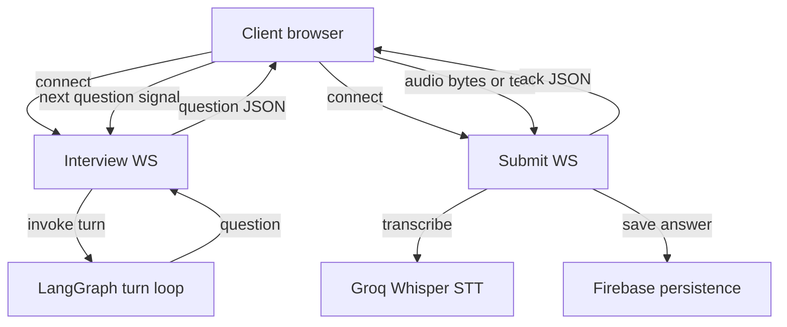

# Interview API

## Resume upload and session creation

`POST /resume/{username}` expects a multipart form-data payload with a `resume`
PDF file. The route parses the PDF, segments sections, builds the ChromaDB
vector index, creates an interview session under `interviews/{session_id}`, and
returns session metadata.

### Response format

```json
{
  "username": "candidate_name",
  "session_id_str": "3fa85f64-5717-4562-b3fc-2c963f66afa6",
  "resume_text": "Extracted text content...",
  "rag": {
    "status": "success",
    "username": "candidate_name",
    "sections": ["summary", "skills", "experience", "past projects"],
    "chunks_indexed": 6
  },
  "session": {
    "session_id": "3fa85f64-5717-4562-b3fc-2c963f66afa6",
    "status": "created"
  }
}
```

## WebSocket communication

<!-- mermaid-checked: no \n, no em-dash/en-dash, no {} in labels, subgraphs are id["label"], arrows are -->|"label"|, all subgraphs closed by end, ids unique -->


### State control socket (`/interview/{username}/{session_id}`)

| Direction | Event payload | Meaning |
| --- | --- | --- |
| Server to Client | `{"status": "in_progress", "question_number": 1, "question": "...", "is_last_question": false}` | Next question generated and ready for candidate |
| Client to Server | `{"action": "next_question", "question_number": 1, "answer": "..."}` | Client confirmation of submitted answer |
| Server to Client | `{"status": "completed", "questions": {...}, "answers": {...}, "evaluation_memory": {...}}` | Final question answered and session complete |

### Answer intake socket (`/submit/{username}/{session_id}`)

| Input type | Payload | Behavior |
| --- | --- | --- |
| Binary frames | Audio byte stream (`audio/webm`, `audio/wav`) | Transcribes with Groq Whisper, saves submission, and sends acknowledgment |
| Text frames | JSON: `{"answer": "candidate text"}` | Saves answer text directly and sends acknowledgment |

Response acknowledgment:

```json
{
  "type": "audio_and_question_received",
  "status": "success",
  "question_number": 1,
  "question": "Can you explain the difference between processes and threads?",
  "answer_txt": "A process is an executing program...",
  "submission": {
    "question_number": 1,
    "timestamp": "2026-10-22T01:00:00"
  }
}
```

## Text-to-speech

`POST /interview/tts` (alias `/tts`) synthesizes natural voice audio via
UnrealSpeech.

| Field | Type | Description |
| --- | --- | --- |
| `text` | string | Spoken text (clipped at 1,000 characters per stream call) |
| `voice` | string | Voice identifier (e.g. `Daniel`, `Charlotte`, `Rowan`, `Emily`) |
| `speed` | string | Pitch/speed adjustment (defaults to `"0"`) |
| `pitch` | string | Pitch setting (defaults to `"1"`) |

Response returns base64 MP3 content:

```json
{
  "status": "success",
  "audioContent": "//uQZ...",
  "format": "audio/mp3",
  "voice": "Daniel",
  "provider": "unrealspeech",
  "cached": false
}
```

## Review endpoints

| Endpoint | Method | Key parameters | Response |
| --- | --- | --- | --- |
| `/review/{username}` | `POST` | `session_id`, `rating`, `feedback`, `technical_score`, `communication_score`, `strengths`, `improvements`, `decision` | Saved review record |
| `/review/{username}/{session_id}` | `GET` | `username`, `session_id` | Single review object |
| `/reviews/{username}` | `GET` | `username` | List of review records |
| `/interview/{session_id}` | `GET` | `session_id` | Session document |
| `/interviews/{username}` | `GET` | `username` | List of candidate sessions |
| `/interview/{session_id}` | `DELETE` | `session_id` | Deletion status |
