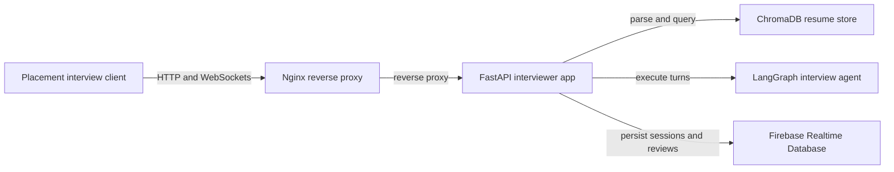

# Interview Architecture

The interview service is an autonomous, conversational technical interview
system running as a FastAPI microservice alongside the Flask application. It
pairs LangGraph decision workflows with ChromaDB resume RAG, Groq Whisper
speech-to-text, and UnrealSpeech text-to-speech.

<!-- mermaid-checked: no \n, no em-dash/en-dash, no {} in labels, subgraphs are id["label"], arrows are -->|"label"|, all subgraphs closed by end, ids unique -->

## System role and integration

Unlike the question generation workflows which return complete question papers,
the interview service runs a stateful, interactive session across two coordinated
WebSockets:

1. **State coordination socket (`/interview/{username}/{session_id}`)**: Drives
   the turn-by-turn LangGraph agent, sends generated questions to the client,
   and closes upon interview completion.
2. **Answer intake socket (`/submit/{username}/{session_id}`)**: Receives binary
   audio chunks or typed text answers, runs Whisper transcription, and commits
   submissions to Firebase before waking the next question generation turn.

## Subsystem overview

| Component | Technology | Purpose |
| --- | --- | --- |
| Service Entrypoint | `interviewer/main.py` | FastAPI app, REST endpoints, and WebSocket handlers |
| Agent Engine | `interviewer/app/agent.py` | LangGraph agent with answer evaluation, decider, and tool calling |
| Resume RAG | `interviewer/app/rag.py` | Section extraction and ChromaDB vector search |
| Speech Services | `interviewer/app/tools.py`, `interviewer/app/tts_service.py` | Groq Whisper STT and UnrealSpeech TTS |
| Persistence | `interviewer/app/firebase_service.py` | Firebase Realtime Database interview sessions and reviews |
| Reverse Proxy | `nginx.conf` | Dynamic routing, SSL offloading, and WebSocket upgrade forwarding |
| Client Interface | `frontend/src/components/PlacementInterview.js` | Audio recording, real-time speech synthesis, and live interaction |
