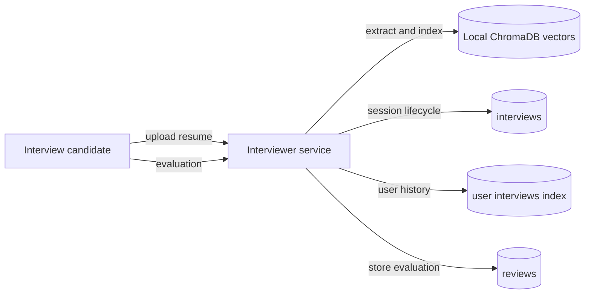

# Interview Data and Persistence

Interview sessions, live candidate transcripts, and post-interview evaluations
are stored across Firebase Realtime Database and local ChromaDB vector indexes.

<!-- mermaid-checked: no \n, no em-dash/en-dash, no {} in labels, subgraphs are id["label"], arrows are -->|"label"|, all subgraphs closed by end, ids unique -->

## Storage locations

| Path / Directory | Technology | Contents and purpose |
| --- | --- | --- |
| `interviews/{sessionId}` | Firebase Realtime Database | Session state, generated questions, submitted answers, evaluations, and RAG metadata |
| `user_interviews/{username}/{sessionId}` | Firebase Realtime Database | Compact index of interview sessions per user |
| `reviews/{sessionId}` | Firebase Realtime Database | Hiring recommendation, scores, strengths, and feedback |
| `user_reviews/{username}/{sessionId}` | Firebase Realtime Database | Compact review index by candidate username |
| `./resume/{username}/` | Local file system | Raw parsed resume text and section text files (`experience.txt`, `past_projects.txt`, etc.) |
| `./resume/{username}/chromadb` | ChromaDB persistent store | Section chunk embeddings for semantic retrieval via `query_resume_section` |

## Data lifecycle

1. **Resume upload**: The candidate uploads a PDF resume. The service extracts
   text via PyMuPDF, segments it by section headers, writes text files to disk,
   and populates the ChromaDB collection `resume_{username}`. A new session is
   recorded under `interviews/{sessionId}` and `user_interviews/{username}/{sessionId}`.
2. **Turn-by-turn answers**: Each question is persisted under
   `interviews/{sessionId}/questions/{qNum}`. Answer text and binary audio
   transcriptions are stored in `interviews/{sessionId}/answers/{qNum}` and
   logged as discrete submissions with timestamps.
3. **Session completion**: When the question threshold is met,
   `complete_interview` writes the final questions, answers, and evaluation
   notes, updating session status to `completed`.
4. **Reviews**: Post-interview evaluations can be submitted to `/review/{username}`,
   writing records to `reviews/{sessionId}`, `user_reviews/{username}/{sessionId}`,
   and the embedded session object.
