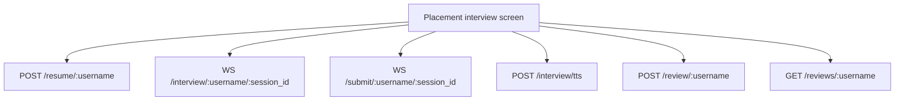

# Interview Routes

The interview service exposes REST and WebSocket routes defined in
[interviewer/main.py](../../interviewer/main.py). All endpoints are routed
through the Nginx gateway.

<!-- mermaid-checked: no \n, no em-dash/en-dash, no {} in labels, subgraphs are id["label"], arrows are -->|"label"|, all subgraphs closed by end, ids unique -->

## Route summary

| Protocol | Route | Handler purpose |
| --- | --- | --- |
| `POST` | `/resume/{username}` | Uploads PDF resume, builds RAG store, and initializes session |
| `WS` | `/interview/{username}/{session_id}` | Drives turn-by-turn LangGraph agent questions and completion |
| `WS` | `/submit/{username}/{session_id}` | Receives audio bytes or text, transcribes, and saves answers |
| `POST` | `/interview/tts` | Synthesizes spoken audio from text using UnrealSpeech |
| `POST` | `/review/{username}` | Creates or updates an interview review |
| `GET` | `/review/{username}/{session_id}` | Retrieves an evaluation review for a specific session |
| `GET` | `/reviews/{username}` | Returns all reviews recorded for a candidate |
| `GET` | `/interview/{session_id}` | Fetches raw session data including transcript and answers |
| `GET` | `/interviews/{username}` | Lists all interview sessions for a candidate |
| `DELETE` | `/interview/{session_id}` | Deletes session records and associated reviews |
| `GET` | `/interview/health` | Health check endpoint |

## Connection lifecycle

1. **Setup**: The client posts a PDF to `/resume/{username}`. The response
   returns a generated `session_id_str`.
2. **WebSocket connection**: The client opens two concurrent WebSockets:
   `/interview/{username}/{session_id}` and `/submit/{username}/{session_id}`.
3. **Question delivery**: The interview socket triggers the LangGraph agent and
   emits `{"status": "in_progress", "question_number": n, "question": "..."}`.
4. **Answer intake**: The candidate speaks or types. The submit socket processes
   the payload and notifies the interview socket via an in-memory event.
5. **Session end**: When the maximum questions are answered, the interview
   socket broadcasts `{"status": "completed"}` with the full transcript and
   closes cleanly.
