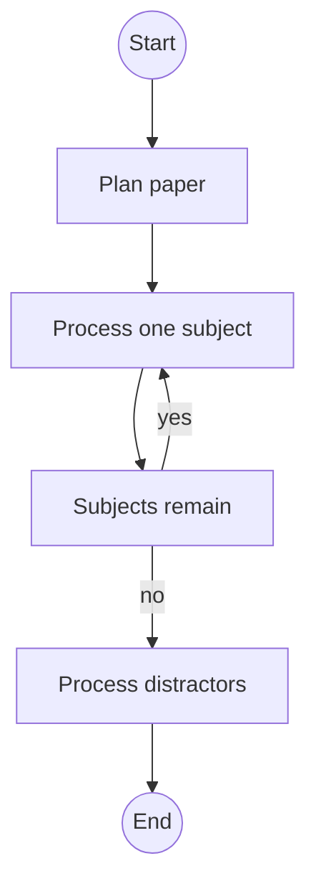

# JEE Agent

The JEE agent is a LangGraph workflow in
[backend/agents/jee/agent.py](../../backend/agents/jee/agent.py). It creates a
paper from subject and concept weightage, boosts concepts returned by weak
concept analysis, retrieves question and NCERT context, generates a question,
and adds distractors.

<!-- mermaid-checked: no \n, no em-dash/en-dash, no {} in labels, subgraphs are id["label"], arrows are -->|"label"|, all subgraphs closed by end, ids unique -->

## Workflow stages

1. `plan_paper` distributes each subject's question count with the
   largest-remainder method.
2. `process_subject` retrieves context and generates one question at a time.
3. `process_distractor` normalizes model output, generates distractors, and
   keeps a complete A-D option set.
4. The graph returns `final_paper` and a durable `errors_encountered` list.

The streaming node names are part of the contract with
[backend/services/job_manager.py](../../backend/services/job_manager.py):
`plan_paper`, `process_subject`, and `process_distractor` should not be
renamed without updating the job manager.

## Personalization

The paper service returns up to ten concepts with the most incorrect answers.
The agent applies a two-times weight boost to matching concepts before
allocation. A user with no results receives the normal concept distribution.
