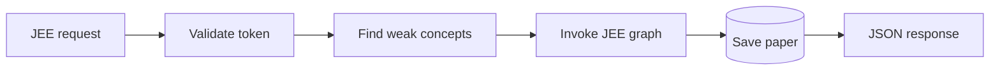

# JEE API

## Generate a paper

`POST /generate-paper` expects a JSON body containing `token`. The backend
validates the token, calculates weak concepts, invokes the JEE agent, saves
the paper, and returns the generated paper with `paper_id`.

The background alternative is:

1. `POST /start-paper-generation` with `token`.
2. Poll `GET /paper-generation-status/:job_id`.
3. Use the returned `paper_id` when the job completes.

## Read and manage papers

| Endpoint | Request | Result |
| --- | --- | --- |
| `/get-paper-for-test` | `token`, `paperId` | A saved paper |
| `/retrieve-papers` | `token` | User papers and deleted IDs |
| `/delete-paper` | `token`, `paper_id` | Marks an owned paper deleted |

## Submit and analyze a test

`POST /submit-test-result` expects `token`, `userName`, and `testResult`.
`testResult` includes `paperId`, `answers`, `timeSpent`, and `completedAt`.
The response includes `resultId`, score, total questions, and percentage.

`POST /get-user-analytics` expects `token` and `userName`, then returns
stored results with paper details when available.

<!-- mermaid-checked: no \n, no em-dash/en-dash, no {} in labels, subgraphs are id["label"], arrows are -->|"label"|, all subgraphs closed by end, ids unique -->

