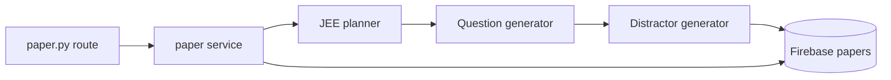

# JEE Architecture

JEE mode is the retrieval and personalization-heavy part of the backend.

<!-- mermaid-checked: no \n, no em-dash/en-dash, no {} in labels, subgraphs are id["label"], arrows are -->|"label"|, all subgraphs closed by end, ids unique -->

The agent intentionally exposes a small graph surface while keeping retrieval
and model-specific details in `backend/agents/jee/tools.py`. This separation
lets tests exercise allocation, normalization, and graph behavior without
requiring a live model provider.
