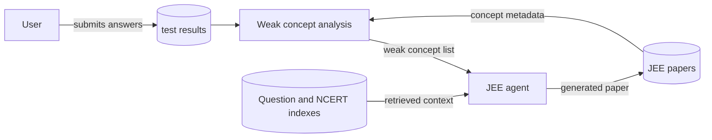

# JEE Data Flow

JEE generation reads the user's historical results and stores the generated
paper and later test result in Firebase.

<!-- mermaid-checked: no \n, no em-dash/en-dash, no {} in labels, subgraphs are id["label"], arrows are -->|"label"|, all subgraphs closed by end, ids unique -->

JEE paper records contain parallel lists for question number, subject,
concept, weightage, question text, options, difficulty, correct answer,
explanation, and distractor rationales. Ownership fields and a creation
timestamp are added before persistence.

See the [shared database guide](../database.md) for Firebase paths and
credential handling.
