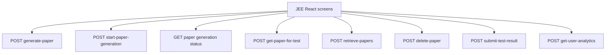

# JEE Routes

JEE mode uses paper-generation routes plus shared paper and result routes.

<!-- mermaid-checked: no \n, no em-dash/en-dash, no {} in labels, subgraphs are id["label"], arrows are -->|"label"|, all subgraphs closed by end, ids unique -->

The synchronous endpoint is used for a direct response. The background flow
creates a job, streams agent events internally, and exposes status through the
job map. JEE tests use `/get-paper-for-test` and `/submit-test-result`.
