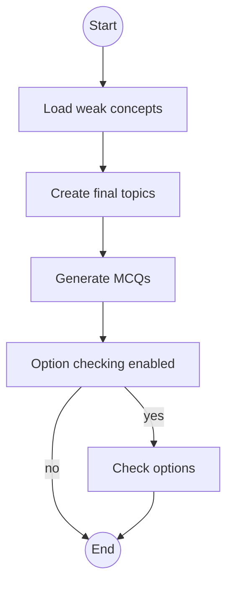

# Placement Agent

The placement agent is a compact LangGraph workflow in
[backend/agents/placement/agent.py](../../backend/agents/placement/agent.py).
It selects topics, generates one MCQ for each selected topic, and optionally
checks whether the generated options are valid.

<!-- mermaid-checked: no \n, no em-dash/en-dash, no {} in labels, subgraphs are id["label"], arrows are -->|"label"|, all subgraphs closed by end, ids unique -->

## Workflow stages

1. `weak_concept_priority` loads the user's weak concepts.
2. `plan_paper` calls `create_final_topics`.
3. `question_generation` builds the list-based paper schema.
4. `option_checker` is conditionally executed when `option_checker` is true.

Placement generation is synchronous in the current route and is saved under
the `placements` Firebase path.
