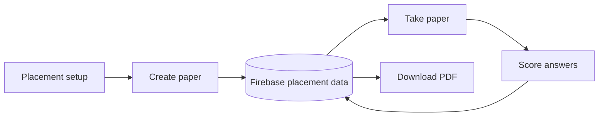

# Placement API

## Generate

`POST /placement_question` expects `token`, `question_total`, `target_topic`,
`model`, and `option_checker`. The route validates the token, invokes the
placement graph, adds ownership metadata, saves the record under
`placements/{paper_id}`, and returns the generated paper.

## History and tests

| Endpoint | Important fields | Behavior |
| --- | --- | --- |
| `/placement_paper_id` | `token` | Returns placement paper IDs for the user |
| `/placements_take_test` | `token`, `paper_id` | Returns a saved placement paper |
| `/placements_submit_test` | `token`, `paper_id`, `answer`, `time` | Scores answers and saves a result |
| `/placement_download_pdf` | `token`, `paper_id` | Returns a PDF attachment |

<!-- mermaid-checked: no \n, no em-dash/en-dash, no {} in labels, subgraphs are id["label"], arrows are -->|"label"|, all subgraphs closed by end, ids unique -->

