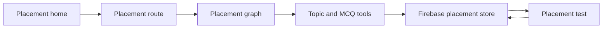

# Placement Architecture

Placement mode follows the simpler agent shape used by the frontend's
placement flow.

<!-- mermaid-checked: no \n, no em-dash/en-dash, no {} in labels, subgraphs are id["label"], arrows are -->|"label"|, all subgraphs closed by end, ids unique -->

Unlike JEE generation, placement generation does not use the JEE background
job manager. Its graph returns a complete paper in one invocation and the
route persists it before responding.
