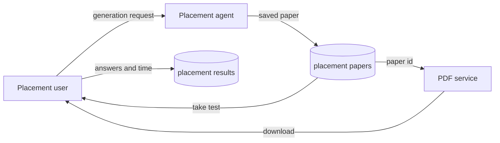

# Placement Data Flow

Placement papers and placement test results are stored separately from JEE
papers.

<!-- mermaid-checked: no \n, no em-dash/en-dash, no {} in labels, subgraphs are id["label"], arrows are -->|"label"|, all subgraphs closed by end, ids unique -->

Placement paper records include generated questions, options, correct answers,
explanations, topics, `user_uid`, `question_total`, and `target_topic`.
Placement scoring writes a result under
`test_results/placements/{resultId}`.
