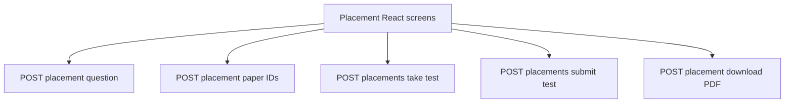

# Placement Routes

Placement screens call the placement-specific routes in
`backend/routes/papers_crud.py`.

<!-- mermaid-checked: no \n, no em-dash/en-dash, no {} in labels, subgraphs are id["label"], arrows are -->|"label"|, all subgraphs closed by end, ids unique -->

The create route generates and persists a placement paper. History requests
return IDs belonging to the authenticated user. Take-test loads a saved paper,
submit-test scores answers in order, and the PDF route streams a generated
file.
