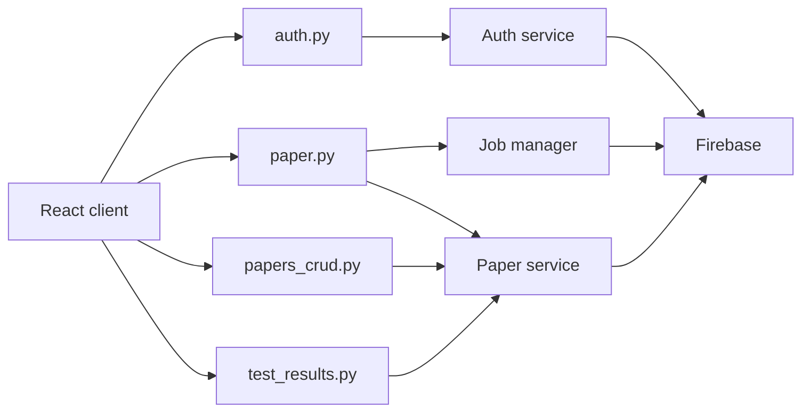

# Routes

All routes are registered without a URL prefix. The frontend sends JSON
requests to the API URL configured in `frontend/src/apiConfig.js`.

<!-- mermaid-checked: no \n, no em-dash/en-dash, no {} in labels, subgraphs are id["label"], arrows are -->|"label"|, all subgraphs closed by end, ids unique -->

## Route groups

| Blueprint | Routes |
| --- | --- |
| `auth` | `/signup`, `/login` |
| `paper` | `/generate-paper`, `/start-paper-generation`, `/paper-generation-status/:job_id`, `/user-active-jobs`, `/cancel-paper-generation/:job_id`, `/cleanup-old-jobs` |
| `papers_crud` | `/get-paper-for-test`, `/delete-paper`, `/retrieve-papers`, `/placement_question`, `/placement_paper_id`, `/placements_take_test`, `/placements_submit_test`, `/placement_download_pdf` |
| `test_results` | `/submit-test-result`, `/get-user-analytics` |
| application | `/health` |

The `:job_id` and `:paper_id` notation in this table means a URL path
parameter. Flask declares those parameters with angle-bracket syntax.

See the [API reference](api.md) for methods, authentication, and response
intent. See the [JEE route details](jee/routes.md) and [placement route
details](placement/routes.md) for mode-specific flows.
